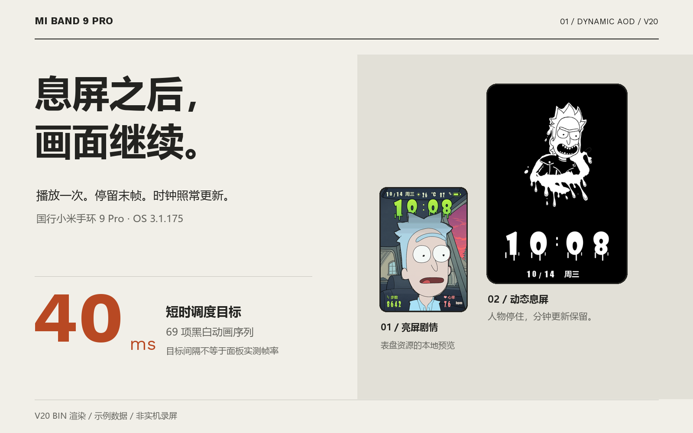
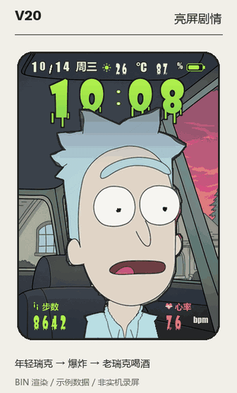
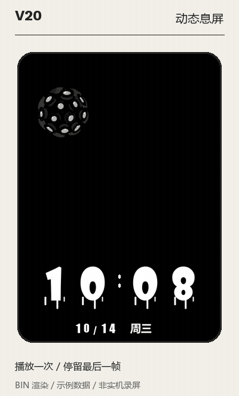
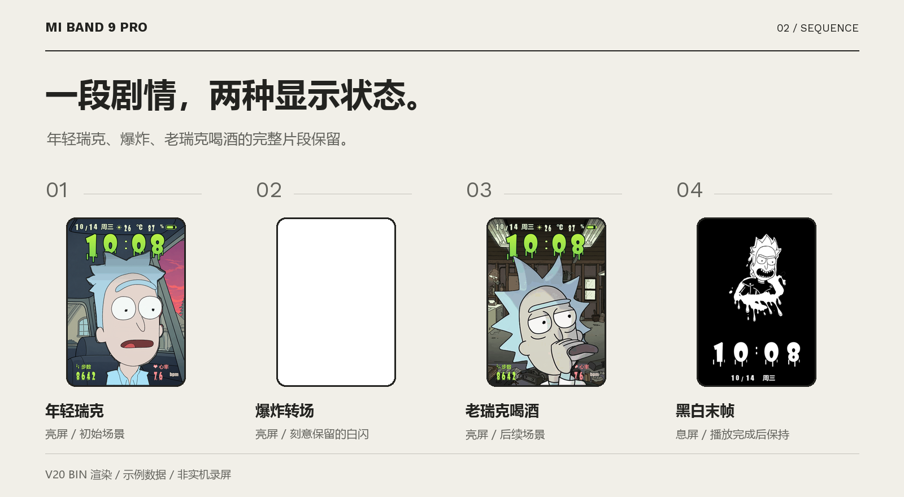
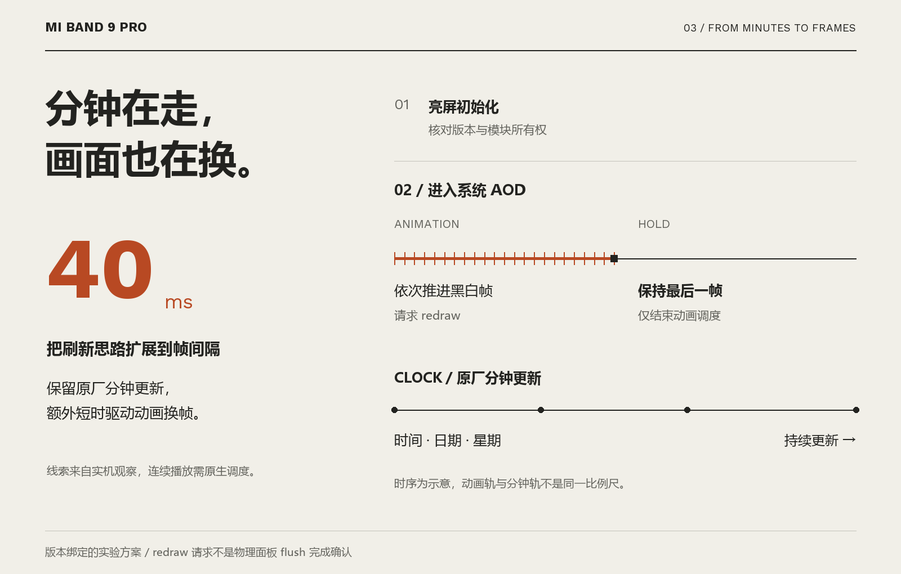
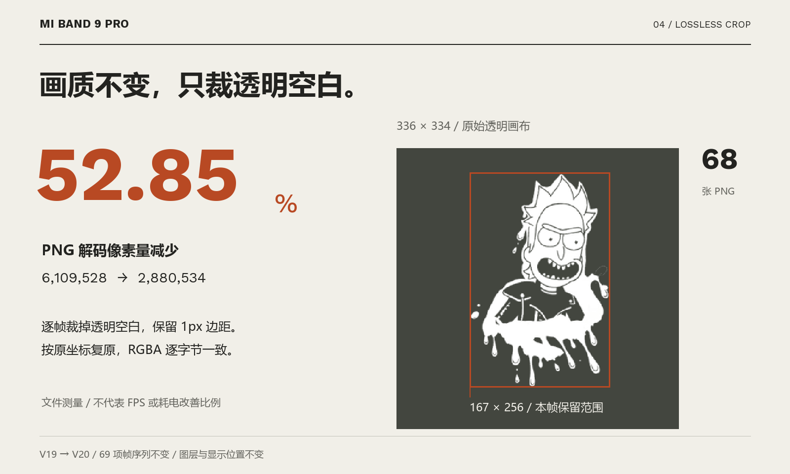

# 小米手环 9 Pro 动态息屏实验



[](https://github.com/TrueYuanYing/miband9pro-dynamic-aod/actions/workflows/tests.yml)

**系统进入息屏后，自动播放一次黑白动画，停在最后一帧；时间、日期和星期继续更新。**

在国行小米手环 9 Pro `n67cn`、OS `3.1.175` 上，通过表盘 BIN 携带 Lua 与自有原生 RAM 模块，在系统进入 AOD 后短时推进动画；提交最后一帧后停止动画换帧，保留原生时间、日期、星期的分钟更新。

这是固件版本绑定的实验方案。它没有生成或刷写修改固件，也不采用低亮度前台常亮来模拟 AOD。此前自动播放的基线及 50ms 版本有本项目用户的实机反馈；当前 40ms 优化版只完成离线检查，`25fps` 是调度目标，不是面板实测值。原生 RAM 执行与回调适配可能导致异常，不能承诺适用于其他版本或所有原有功能。

## 看效果

<table>
  <tr><th>完整亮屏剧情</th><th>动态息屏与末帧保持</th></tr>
  <tr>
    <td align="center"></td>
    <td align="center"></td>
  </tr>
</table>

GIF 从最终私人 V20 的 BIN 资源和图层本地渲染，再做浏览器预览压缩；不是实机录屏，也不是公开加固版的硬件验证。亮屏 GIF 为12.5fps编码，息屏预览按40ms目标时序；示例时钟的分钟变化做了加速。实际设备FPS和功耗尚未测量。GIF循环用于网页展示，每轮对应一次进入AOD后的播放。



## 怎样实现



正常页面延迟初始化版本绑定的自有 RAM 模块。进入系统 AOD 后短时推进 Lua 动画，到最后一帧请求 redraw 后只停动画计时器，保留系统分钟更新链。这里没有物理面板 flush ACK。[完整方法与边界](docs/METHOD.md)。

## V20怎样减轻解码负担



对68张 PNG 逐帧保留1px透明边距，裁掉空白后按原偏移复原；69项帧序列保持不变。解码像素量从6,109,528减少到2,880,534，下降52.85%，复原RGBA逐字节相同。这是文件测量结果，不表示FPS或耗电改善了同样比例。

## 探索中的关键转折


从找回瑞克原素材、修复亮屏剧情与人物遮挡开始，一直记录到V20。**关键转折是用户发现：分钟变化时，整幅息屏画面也会更新。**这启发我们保留原厂分钟链，并另外建立短时动画调度，实现连续换帧、末帧保持和日历共存。[查看完整探索历程](docs/HISTORY.md)。

## 快速开始

```bash
python -m pip install .
python -m band9pro_aod check-firmware /path/to/3.1.175.bin
python examples/make_frames.py frames
python -m band9pro_aod pack --firmware /path/to/3.1.175.bin --base-bin /path/to/your-aod-scaffold.bin --frames frames --out my-dynamic-aod.bin --face-id 810119901 --title "Dynamic AOD Demo" --accept-experimental
```

你需要自行提供有权使用的素材、原版固件和兼容表盘。仓库不附原固件、私人BIN或原始动画帧；`assets/`仅提供压缩的成品展示预览，角色相关媒体不属于MIT代码许可。[媒体范围](assets/README.md)。可执行示例只生成本项目的几何图形。输出必须是新文件，工具不覆盖输入。

兼容表盘必须使用本项目识别的双页面 `0x800/4` BIN 结构，并已经有可见的 AOD Lua 入口 `0x050000dc` 及其资源。普通第三方表盘不一定具备该结构。工具会拒绝没有入口、损坏的索引或带有未知正常页面 Lua 的输入，不擅自覆盖别人的逻辑。原生时间和日历组件由基底提供，本工具不会凭空添加未核实的数据源。

安装时在 AstroBox 选择“安装表盘”，不要选择“安装固件”。先保留可切回的原表盘；安装后亮屏停留约2秒，再进入系统息屏。正常重启不会保留本项目的 RAM 指令改动，但异常情况下能否顺利重启或恢复未完成普遍验证。

## 方法和代码

- [实现方法及边界](docs/METHOD.md)：分钟更新和短时动画调度的分工、入口、停止状态。
- [探索历程](docs/HISTORY.md)：首帧限制、页面格式、原生入口、退回可用版本以及 PNG 优化。
- `band9pro_aod/`：严格 BIN 读写、透明 PNG 裁剪、运行模板和命令行。
- `band9pro_aod/runtime/`：从本项目 V20 提炼的运行代码和原始自有模块，不重新编译启动模板。
- `native/`：模块 C、Thumb 入口、链接脚本和精确版本绑定。

公开源码增加了日志失败清理、回滚隔离和资源保护，经过离线故障注入检查；它并非私人 V20 BIN 的逐字节重打包，也未实机验证。原模块安装到读回验收之间仍有 IO 失败窗口，详见方法文档。

当前目标 AP SHA256：

```text
4f43b325addd6d9e6e7c7e2a4d00ffe3f23d5fb1560d8fe503544002ac1f516b
```

对本项目 V19 的68个 PNG，逐帧保留1px透明边距并按原坐标复原后，解码像素量减少52.85%，RGBA复原逐字节相同。保持69项原帧序列；相同图片和位置不重复解码。40ms目标调度播放完后暂停动画计时器，分钟/日历刷新继续由系统管理。

## 测试

```bash
python -m pip install ".[test]"
python -m unittest discover -s tests -v
```

默认检查包索引、像素复原和实际 Lua 生命周期。额外提供自己提取的原版 AP：设置 `AOD_STOCK_AP` 环境变量，原生测试才会运行真实 Thumb 指令；未提供时明确跳过，不把跳过当作通过。OS、缓存、MPU总线、面板行为是测试替身，不能据此保证实机安全、功耗或帧率。

## 来源与许可

MIT 适用于本仓库代码，固件和第三方素材不属于本仓库许可范围。[来源说明](docs/SOURCES.md)列明研究参考。本项目不宣称全球首创，不将本地渲染视频当作实机证据。欢迎提供精确型号、固件版本、可复现步骤及非敏感日志；请勿公开配对密钥、账号或完整原固件。
