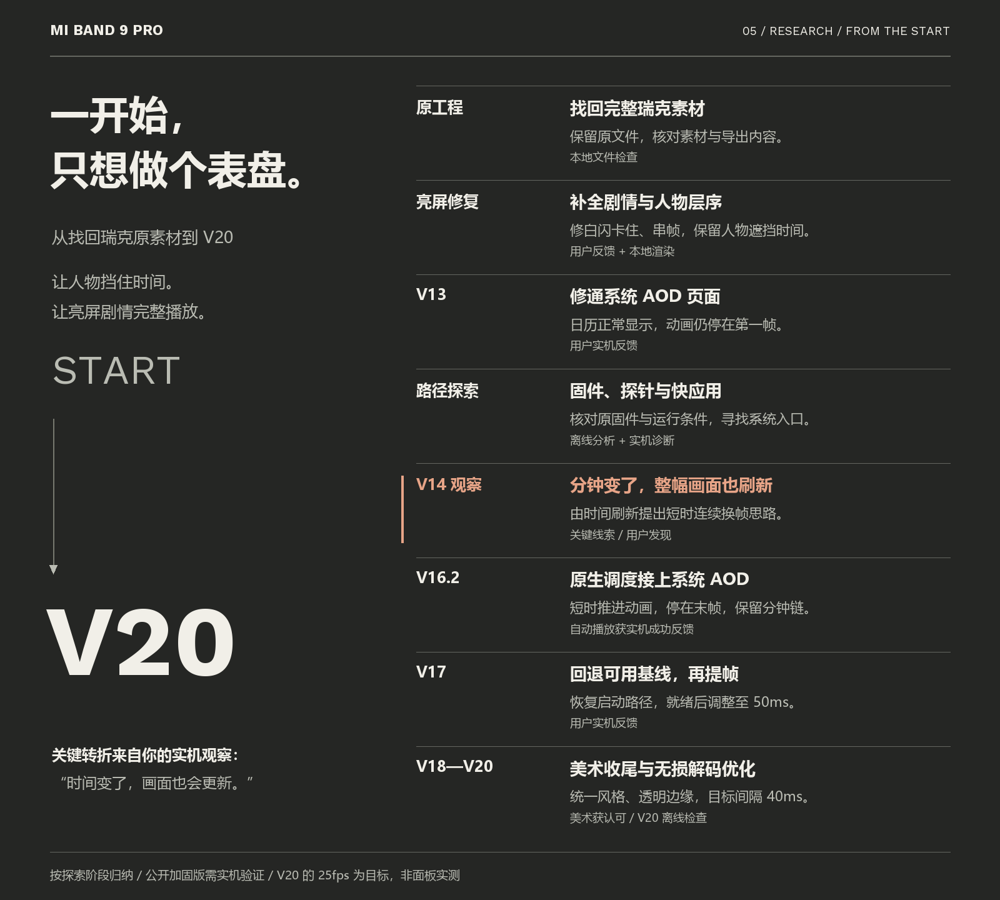

# 探索历程

项目从一个瑞克和莫蒂表盘的愿望开始：亮屏完整播放年轻瑞克、爆炸白闪与老瑞克喝酒，人物能遮挡时间；进入系统息屏后，黑白动画播放一次并停在末帧，时间、日期和星期继续更新。我们先找回原素材和工程，修画面与页面，再逐步研究系统刷新和运行入口。

## 从最初素材到最终版本

| 阶段 | 遇到的困难 | 尝试与结果 | 证据与收获 |
|---|---|---|---|
| 原工程定位 | 早期BIN没有后来添加的AOD页面，成品和素材分散 | 找回瑞克原素材及工程，在副本上分析 | 本地文件检查；保留原文件 |
| 完整亮屏剧情 | 预览遗漏白闪后的老瑞克喝酒片段 | 保留年轻瑞克、爆炸和老瑞克的完整剧情 | 本地渲染；不能只看动画前半段 |
| 人物与界面 | 人物未贴底、轮廓缺损，背景割裂，数字与组件拥挤 | 修边缘、背景及RM字体；人物在时间和组件上方，保留天气与跳转 | 用户反馈与图层检查 |
| 实机亮屏回归 | 白屏卡住、年轻与老瑞克串帧、身体和脸抖动 | 调整帧与图层，保留用户指定的爆炸色偏和分裂特效 | 用户实机反馈；故意特效与故障要区分 |
| 系统AOD页面至V13 | 绿色空背景、专属页面不可见，后来只有首帧 | 修页面格式和宿主，时间日期星期终于正常 | 用户确认V13可见；显示正确不等于调度正确 |
| 普通动画与Lua尝试 | 原生sprite与Lua动画仍不能持续推进 | V14/V15检查帧资源、Image动画和计时器 | 页面已有后续帧，持续AOD调度仍未建立 |
| 原固件分析 | 用户希望直接改固件，整机验证、签名与恢复路径未完成 | 核对3.1.175指纹，静态分析与局部执行屏幕状态、暂停链及分钟更新链 | 离线分析；未发布或刷写改造OTA |
| 合并只读诊断 | 早期探针黑屏，亮屏/AOD入口不同，ABI与缓存状态待核对 | 修宿主、合并检查项，取得版本、对象和缓存快照 | 用户照片与局部检查；每一层需独立核实 |
| 快应用备选 | 手动低亮度前台不能自动接管真正系统AOD | 探索前台方案与自动打开可能性，继续寻找系统入口 | 接口分析；最终实现没有用前台常亮冒充AOD |
| **关键观察：分钟刷新** | **用户发现V14在时间跳到下一分钟时，人物画面也更新** | **用户提出把这种刷新思路用于动画：短时间内连续换帧，结束后停住** | **创新切入点来自用户实机观察；分钟事件本身不能直接变成40ms事件** |
| V16.2原生入口 | 普通表盘timer在AOD下缺少持续调度 | 表盘Lua携带自有Thumb模块；在RAM接入原回调与UI线程调度 | 自动动态AOD获用户成功反馈 |
| 隐藏触发与自动初始化 | 可见按钮影响排布，点击或初始化路径可能失效 | 保留可用加载模板，处理反馈与延迟初始化 | 用户反馈；最终目标为系统AOD自动播放 |
| V17提帧回归与Restore | 改模块或目录后无震动、动画再次不动，组件点击异常 | 退回用户可用基线，缩小差异恢复启动和组件 | 用户确认恢复版可用 |
| V17 AOD Smooth | 提帧容易破坏原生启动方式 | 模块ready后才调整自有RAM间隔到50ms | 用户确认能播放，可继续沿用 |
| V18/V19美术收尾 | 组件色框突兀、衣服残边、AOD方形亮块、日期贴边 | 统一配色字形、逐帧修边与透明黑白PNG、内移日期 | 用户认可整体效果，随后只要求优化性能 |
| V20与开源整理 | 透明大画布增加解码负担，私人成品不能混入通用代码 | 无损裁图、坐标复原、重复帧跳过；40ms目标；整理方法、示例和测试 | 解码像素少52.85%，RGBA复原一致；V20面板FPS未测 |

## 为什么“时间刷新”是关键转折

用户的观察改变了排查方向：AOD不是一幅永远不能更新的静态图。既然分钟变化能使整幅页面刷新，后续动画帧也有机会被显示。我们据此把问题拆成两部分：保留时间与日历的原厂更新；另为进入AOD后的几秒提供连续换帧的调度。

最终代码把这条思路落到表盘Lua和版本绑定的原生RAM模块。系统进入AOD后，短时pulse驱动Lua推进帧并请求redraw；末帧请求提交后结束动画换帧，原来的分钟更新继续运行。**创新来自把时间刷新中的“画面可更新”机制用于动画设计，并将分钟节奏与短时动画节奏分开。**并没有把设备系统时钟改快，也没有声称纯Lua调用分钟接口即可实现25fps。

自动播放基线及50ms版有用户实机反馈；40ms是V20调度目标。代码只记录redraw请求，没有物理面板flush完成确认。[实现细节与边界](METHOD.md)。

历史按探索阶段和版本归纳，不补造阶段日期、耗时或故障次数。原始素材与私人BIN保留本地，仓库只公开方法、通用代码和压缩展示预览。没有跨机型或长期稳定性结论。
